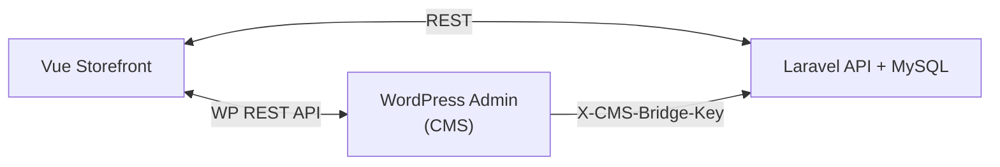

# CraftMarket — Final Project Compliance Matrix

**Course:** Web Systems and Technologies 2 · System Integration and Architecture 1
**Project:** CraftMarket — a commission-based marketplace for Filipino artisans
**Student:** Ashley Jay Sarmiento (BSIT F3)
**Requirements source:** *FINAL PROJECT REQUIREMENTS — Web-Based Business Application with CMS Integration*
**Rubric source:** *Final Project Defense Rubric* (100 points)

This document maps every required component and every rubric criterion to the exact artifact or code that satisfies it. Use it as the single checklist during the defense.

---

## 0. Verdict at a Glance

| Requirement block | Status | Where it lives |
|---|---|---|
| A. Business Proposal (problem, users, value, revenue) | ✅ Complete | [`business-model.md`](business-model.md) |
| B. Web App / User Portal (home, overview, products, features, auth, profile, ≥3 modules) | ✅ Complete | `frontend/src/views/`, `backend/routes/api.php` |
| C. CMS-Based Admin Panel (content, announcements, products, users, reports) | ✅ Complete | WordPress + `cms/craftmarket-sync-plugin/` + `/api/cms-bridge/*` |
| D. System Integration (≥2 options) | ✅ 4 options implemented | Email, PayMongo, QR, Headless CMS REST API |
| E. Database (≥5 tables, relational, ERD) | ✅ 12 domain tables | `backend/database/migrations/`, [`erd.md`](diagrams/erd.md) |
| F. Security (authN, authZ, encryption, validation, sessions) | ✅ Complete | [`security-controls.md`](security/security-controls.md) |
| G. User Roles (≥2) | ✅ 3 roles | Admin, Seller, Customer |
| Required documentation (SRS + 6 design artifacts) | ✅ Complete | [`README.md`](README.md) |

Automated evidence: **35 feature tests / 191 assertions passing** (`php artisan test`).

---

## 1. Required Component A — Business Proposal

| Required element | Where it is answered | Key content |
|---|---|---|
| **Problem Statement** | [`business-model.md`](business-model.md) §2 | Fragmented social-media selling, no escrow protection, no discoverable storefront, no analytics for artisans |
| **Target Users** | [`business-model.md`](business-model.md) §4 | Artisan sellers (primary), craft buyers (primary), platform admin (internal), gift/wholesale buyers (secondary) |
| **Value Proposition** | [`business-model.md`](business-model.md) §3 | Escrow-protected transactions, verified storefronts, low commission, built-in analytics and payouts |
| **Revenue Model** | [`business-model.md`](business-model.md) §5 | 8% commission (Basic) / 3% (Pro), ₱299/month Artisan Pro subscription, payout ledger, unit economics and break-even |

**Revenue model implementation evidence**

| Stream | Code |
|---|---|
| Transaction commission | `OrderController` commission split, `orders.platform_fee`, `order_items.commission_amount` |
| Subscription plans | `SubscriptionController`, `artisan_subscriptions` table, `users.subscription_plan` |
| Payout settlement | `SellerController::payoutSummary`, `PayoutRequest`, `AdminController::updatePayoutRequest` |
| Revenue reporting | `AdminController::reports` → `total_commission`, `commission_ledger`, `payout_summary`, `subscription_revenue.mrr` |

---

## 2. Required Component B — Web App / User Portal

| Required page / feature | Route | View / evidence |
|---|---|---|
| Home Page | `/` | `frontend/src/views/HomeView.vue` (hero, featured crafts, categories, announcement banner) |
| Business Overview | `/about` (and home `#about`) | `frontend/src/views/AboutView.vue` / home sections |
| Services / Products | `/products`, `/products/:id` | `ProductsView.vue`, `ProductDetailView.vue`, `GET /api/products` |
| Features | Home + dashboards | Escrow checkout, reviews, wishlist, inquiries, seller analytics |
| Sign Up | `/register` | `RegisterView.vue`, `POST /api/auth/register` |
| Login | `/login` | `LoginView.vue`, `POST /api/auth/login` (rate limited 5/min/IP) |
| Profile Management | `/profile` | `ProfileView.vue`, `PUT /api/auth/profile`, `PUT /api/auth/password` |
| Main modules (≥3) | — | 1) Marketplace & catalog, 2) Cart/checkout with escrow, 3) Seller dashboard & payouts, 4) Admin CMS/reporting, 5) Reviews/wishlist/inquiries |

**Major modules (requirement: minimum 3)**

| # | Module | Main routes | What it proves |
|---|---|---|---|
| 1 | **Product & Inventory Management** | `/api/products`, `/api/seller/products` | Artisan CRUD, stock, status, image upload, listing limits by plan |
| 2 | **Online Ordering & Escrow Checkout** | `/api/cart`, `/api/orders`, `/api/payment/*` | Cart-only flow, server-recomputed totals, per-item escrow, delivery release |
| 3 | **Seller Analytics, Verification & Payouts** | `/api/seller/analytics`, `/api/seller/payouts`, `/api/admin/sellers/*` | 6-month trend, top products, storefront approval, payout ledger |
| 4 | **Admin Oversight & Reporting** | `/api/admin/*` | Users, roles, products, orders, escrow, payouts, subscriptions, reports |
| 5 | **Engagement** | `/api/products/{id}/reviews`, `/api/wishlist`, `/api/products/{id}/inquiry` | Reviews, wishlist, custom-order inquiries |

---

## 3. Required Component C — CMS-Based Admin Panel

**Platform:** self-hosted **WordPress** (headless / decoupled) with the bundled **CraftMarket CMS Bridge & Sync** plugin.



### 3.1 The five required CMS functions

| Required CMS function | CMS surface | Laravel endpoint | Write support |
|---|---|---|---|
| **1. Website Content** | WordPress Pages (`edit.php?post_type=page`) | `GET /wp-json/wp/v2/pages` | WordPress editor (nonce + `manage_options`) |
| **2. Announcements** | WordPress Posts (`edit.php`) | `GET /wp-json/wp/v2/posts` | WordPress editor |
| **3. Products / Services** | **CraftMarket CMS → Products & Crafts** | `GET /api/cms-bridge/products` · `PATCH /api/cms-bridge/products/{id}/status` | ✅ Status moderation: active / inactive / out of stock / archived |
| **4. User Data** | **CraftMarket CMS → Marketplace Users** | `GET /api/cms-bridge/users` · `PATCH /api/cms-bridge/users/{id}/toggle-active` | ✅ Activate / deactivate (revokes tokens; admins protected) |
| **5. Reports** | **CraftMarket CMS → Escrow Reports** | `GET /api/cms-bridge/reports` | Read-only aggregate dashboard |

### 3.2 CMS management actions added for this requirement

| Action | UI | Server guard |
|---|---|---|
| Change product status | Per-row select + **Update** button | `admin-post.php` + `wp_nonce_field('craftmarket_product_status')` + `current_user_can('manage_options')`; API validates enum |
| Activate / deactivate user | Per-row **Activate** / **Deactivate** button | `wp_nonce_field('craftmarket_toggle_user')` + capability check; API blocks admin deactivation and revokes Sanctum tokens |
| Rich reporting | Cards + escrow ledger + payout summary + MRR + order breakdown + best sellers | `AdminController::reports` aggregate payload |

### 3.3 CMS bridge security

| Control | Implementation |
|---|---|
| Shared secret | `X-CMS-Bridge-Key` compared with `hash_equals` in `VerifyCmsBridgeKey` |
| Fail closed | `503` when `CMS_BRIDGE_KEY` is not configured |
| Unauthorized | `401` for missing or wrong key |
| Least privilege | Bridge cannot touch orders, payments, escrow, payouts, or pricing |
| CSRF | Every WordPress write action uses a nonce |
| Capability | `manage_options` required on every handler |
| Audit trail | `Log::info` records product-status and user-activation changes |

**Demo path:** `http://localhost/craftmarket-cms/wp-admin` → **CraftMarket CMS** → Products / Users / Escrow Reports.

---

## 4. Required Component D — System Integration

Requirement: implement system integration examples (any options). CraftMarket implements **four**:

| Option | Status | Implementation | Demo |
|---|---|---|---|
| **Option 1 — Email (SMTP)** | ✅ | Laravel Mail + 8 Mailables in `backend/app/Mail/`, orchestrated by `NotificationService` | Register/order → Mailpit at `http://localhost:8025` or configured SMTP |
| **Option 2 — Payment (PayMongo)** | ✅ | `PaymentController`, hosted checkout, `WebhookController` with HMAC-SHA256 verification | Checkout → PayMongo → `/payment/status` |
| **Option 5 — QR Code Generation** | ✅ | `qrcode` npm package in `SellerOrdersTable.vue`; backend dispatch code on `order_items` | Seller dashboard → generate/confirm dispatch QR |
| **Option 7 — Third-Party API** | ✅ | Headless WordPress REST API (`/wp-json/wp/v2/*`) consumed by `cmsService.js`; WordPress plugin consumes Laravel API | Homepage announcement banner + CMS pages |

**Pre-wired but optional:** S3-compatible cloud storage (`config/filesystems.php`), Mailpit/SMTP providers, PayMongo test/live keys via `.env`.

**Not implemented (declared honestly):** Google Maps and real SMS gateway. The requirement asks for integration examples, not every option; four options are already satisfied.

---

## 5. Required Component E — Database

| Requirement | Evidence |
|---|---|
| Minimum 5 tables | **12 domain tables** plus framework tables |
| Relational design | Foreign keys, pivot-free normalized structure, `ON DELETE` rules |
| ER Diagram | [`diagrams/erd.md`](diagrams/erd.md) (Mermaid) |
| Schema snapshot | [`database/schema.sql`](database/schema.sql) |
| Source of truth | `backend/database/migrations/` |

**Domain tables**

1. `users` — customers, sellers, admins, subscription fields
2. `seller_profiles` — shop identity and verification
3. `categories` — craft taxonomy
4. `products` — listings, stock, status, media
5. `orders` — order header, totals, escrow status
6. `order_items` — per-seller line items, commission, escrow, dispatch
7. `payments` — gateway references and status
8. `cart_items` — persistent cart
9. `wishlists` — saved products
10. `product_reviews` — ratings and moderation
11. `payout_requests` — artisan cash-out ledger
12. `artisan_subscriptions` — subscription billing records

**Integrity evidence:** server-side money recomputation, snapshot columns (`product_name`, `price`, `commission_amount`), transactional order creation, FK constraints, indexes on foreign keys and lookup columns.

---

## 6. Required Component F — Security

| Required control | Implementation | Evidence |
|---|---|---|
| **Authentication** | Laravel Sanctum bearer tokens, 7-day expiry | `AuthController`, `SANCTUM_EXPIRATION=10080` |
| **Authorization** | `role:admin`, `role:seller,admin` middleware + object-level ownership checks | `routes/api.php`, controllers |
| **Password encryption** | bcrypt hashing (`BCRYPT_ROUNDS=12`), never returned in JSON | `User` casts, `AuthController` |
| **Input validation** | Request validation on every write endpoint; enums, bounds, `exists` rules | Controllers |
| **Session management** | Token revocation on role change/deactivation/logout; CMS deactivation revokes tokens | `UserController`, `CmsBridgeController` |
| **Transport / secrets** | `.env` secrets, HMAC webhook verification, constant-time bridge key | `WebhookController`, `VerifyCmsBridgeKey` |
| **Rate limiting** | Login/register 5/min/IP; public catalog 60/min | `routes/api.php` |
| **XSS** | Vue escaping + DOMPurify on CMS HTML | `cmsService.js`, components |
| **CSRF (CMS)** | WordPress nonces on every write action | `craftmarket-cms-sync.php` |

Full mapping: [`security/security-controls.md`](security/security-controls.md).

---

## 7. Required Component G — User Roles

| Role | Capabilities | Requirement satisfied |
|---|---|---|
| **Administrator** | Manage content, users, roles, products, sellers, orders, payouts, reports | “Manage Content / Users / Generate Reports” |
| **Seller / Artisan** | Manage own products, fulfil orders, view analytics, request payouts, manage shop profile | Marketplace participation |
| **Customer** | Browse, cart, checkout, track orders, review, wishlist, inquire, manage profile | “Access Services / Submit Transactions / Manage Profile” |

Minimum two roles required; **three** implemented.

---

## 8. Required Documentation

| Required artifact | File | Status |
|---|---|---|
| System Requirements Specification (Introduction, Objectives, Scope, Functional, Non-Functional) | [`SRS/system-requirements.md`](SRS/system-requirements.md) | ✅ |
| Use Case Diagram | [`diagrams/use-case.md`](diagrams/use-case.md) | ✅ |
| ER Diagram | [`diagrams/erd.md`](diagrams/erd.md) | ✅ |
| Context Diagram | [`diagrams/context.md`](diagrams/context.md) | ✅ |
| Architecture Diagram | [`diagrams/architecture.md`](diagrams/architecture.md) | ✅ |
| Database Schema | [`database/schema.sql`](database/schema.sql) | ✅ |
| Wireframes | [`diagrams/wireframes.md`](diagrams/wireframes.md) | ✅ |
| Business model (Component A) | [`business-model.md`](business-model.md) | ✅ |
| Security controls | [`security/security-controls.md`](security/security-controls.md) | ✅ |
| Defense guide | [`presentation/defense-guide.md`](presentation/defense-guide.md) | ✅ |
| CMS integration guide | [`../cms/wordpress-integration-guide.md`](../cms/wordpress-integration-guide.md) | ✅ |

---

## 9. Rubric Mapping (100 points)

| # | Criterion | Weight | Why CraftMarket earns a high rating | Where to show it |
|---|---|---:|---|---|
| 1 | **System Functionality** | 30% | End-to-end workflows: registration → catalog → cart → escrow checkout → fulfilment → release → payout → reports. CRUD, auth, reporting, and CMS management all work; 35 automated tests pass | Live demo + `php artisan test` |
| 2 | **UI/UX & Responsiveness** | 15% | Consistent design tokens, responsive grids, mobile nav, loading/empty/error states, accessible forms | Resize browser; wireframes §responsive matrix |
| 3 | **Business Model & Revenue** | 15% | Two revenue streams, unit economics, break-even, MRR and commission reporting, target market | `business-model.md`, CMS reports |
| 4 | **Database Design** | 10% | 12 normalized tables, FKs, snapshot columns, transactions, indexes, ERD | ERD + `schema.sql` + migrations |
| 5 | **Security & Validation** | 10% | AuthN/AuthZ, bcrypt, token revocation, rate limits, validation, signed webhooks, fail-closed bridge, nonces | `security-controls.md` + tests |
| 6 | **Documentation & System Design** | 10% | All seven required artifacts present, plus business, security, and defense docs | `documentation/` |
| 7 | **Presentation & Defense** | 10% | Scripted demo, rubric talking points, Q&A bank, seeded accounts | `defense-guide.md` |

### Rubric level-5 checklist

- **Functionality 5:** all modules functional, integrated, error-free, with CRUD + auth + reporting + workflows.
- **UI/UX 5:** professional, responsive, visually appealing, easy navigation on desktop/tablet/mobile.
- **Business 5:** clear, realistic, sustainable revenue model with target market and commercialization potential.
- **Database 5:** well-structured, normalized, proper relationships, integrity, efficient management.
- **Security 5:** authentication, authorization, password encryption, session management, input validation all implemented.
- **Documentation 5:** SRS, Use Case, ERD, Context, Architecture, DB Schema, Wireframes all present.
- **Presentation 5:** clear, organized, professional, accurate and confident answers.

---

## 10. Defense Demo Script (≈12 minutes)

| Step | Account | Action | Talking point |
|---|---|---|---|
| 1 | Guest | Open `/` and `/products` | Responsive storefront, CMS-driven announcement |
| 2 | Guest | Register a customer | Email integration, validation, bcrypt |
| 3 | Customer | Add to cart → checkout | Cart-only flow, server-recomputed totals |
| 4 | Customer | Pay / confirm | PayMongo hosted checkout + signed webhook |
| 5 | Seller | Open dashboard → analytics → orders | Module depth, escrow held vs released |
| 6 | Seller | Generate dispatch QR → request payout | QR integration + payout rules |
| 7 | Admin | Release escrow → approve/pay payout | Escrow lifecycle and ledger |
| 8 | Admin | Open `/dashboard/admin` reports | Commission, MRR, payout summary |
| 9 | Admin | WordPress → CraftMarket CMS | Five CMS functions |
| 10 | Admin | Change product status; deactivate a customer | CMS write actions, token revocation |
| 11 | Admin | Show product back online / user reactivated | Reversible moderation |
| 12 | — | `php artisan test` | 35 passing tests, 191 assertions |

---

## 11. Known Gaps and Mitigations

| Gap | Impact | Mitigation / next step |
|---|---|---|
| PayMongo live/test keys not yet provisioned | Hosted checkout cannot complete a real charge in the demo environment | Add `PAYMONGO_SECRET_KEY` / `PAYMONGO_PUBLIC_KEY`; local fallback is explicitly non-production and never labeled as real payment |
| Google Maps not integrated | No map picker for delivery address | Address is free-text + validated; Maps is optional under Component D |
| Real SMS gateway not integrated | No outbound SMS | Email notifications cover the workflow; SMS is optional under Component D |
| CMS bridge secret uses a development default | Weak secret if deployed unchanged | Rotate `CMS_BRIDGE_KEY` / `CRAFTMARKET_CMS_BRIDGE_KEY` before deployment |
| SQLite used for local demo | MySQL-specific behavior not exercised locally | Migrations and `schema.sql` target MySQL; switch `DB_CONNECTION=mysql` in production |

---

## 12. Verification Commands

```powershell
# Backend tests (expect 35 passed)
cd backend
php artisan test

# Route inventory for the CMS bridge
php artisan route:list --path=cms-bridge

# Frontend production build
cd ../frontend
npm run build

# PHP syntax check for the WordPress plugin
php -l ../cms/craftmarket-sync-plugin/craftmarket-cms-sync.php
```

**Expected CMS bridge routes**

```text
GET    api/cms-bridge/products
PATCH  api/cms-bridge/products/{id}/status
GET    api/cms-bridge/reports
GET    api/cms-bridge/users
PATCH  api/cms-bridge/users/{id}/toggle-active
```

---

*Last updated: 2026-11-17 · Keep this matrix in sync with `backend/routes/api.php` and the CMS plugin.*
