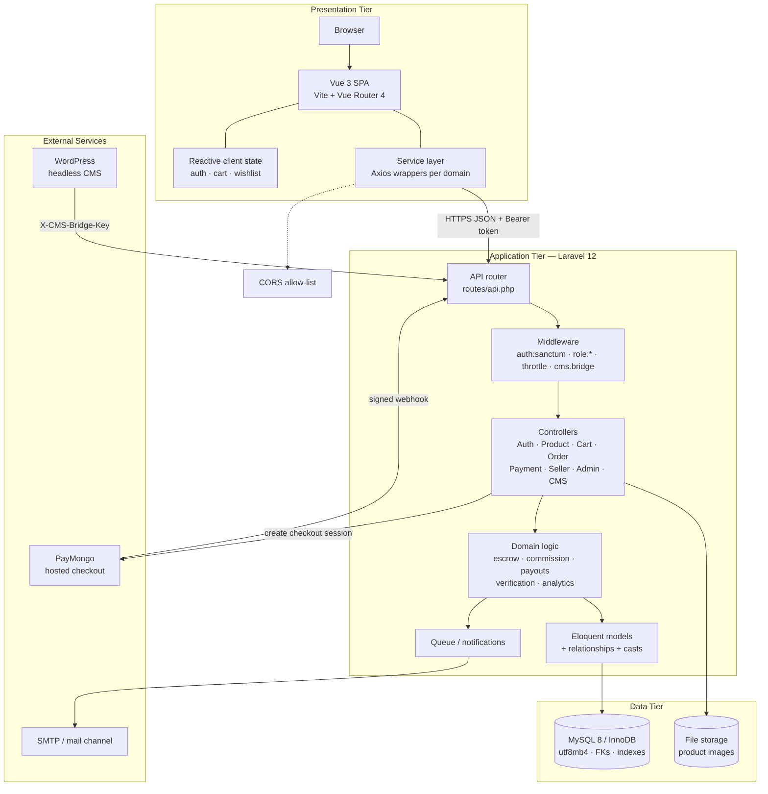
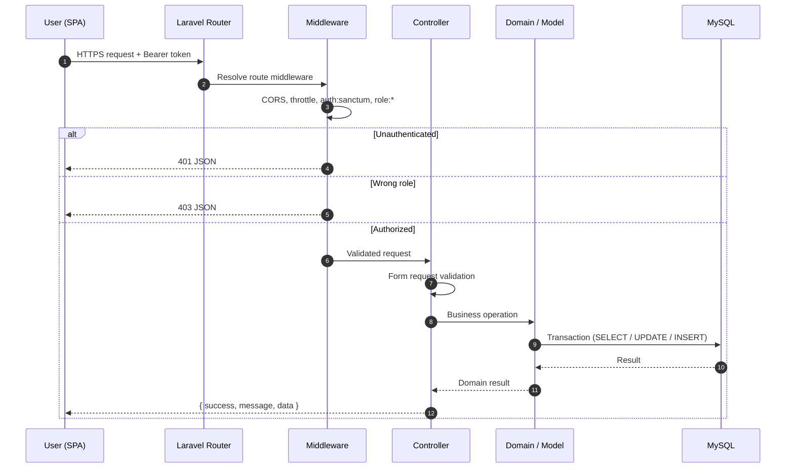
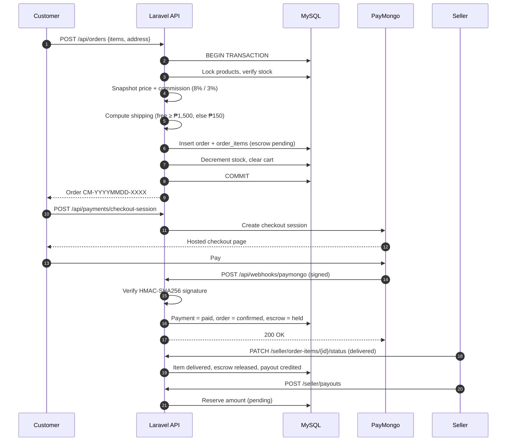
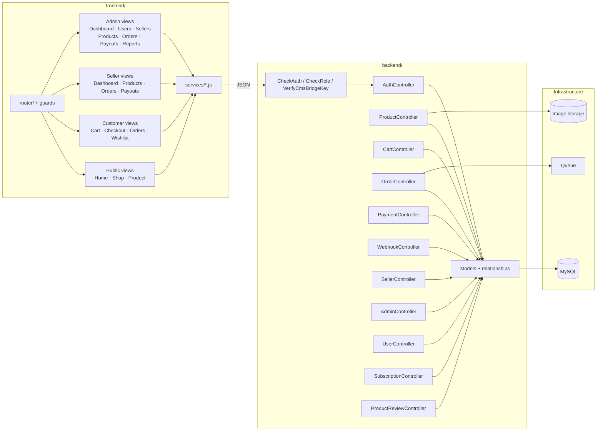
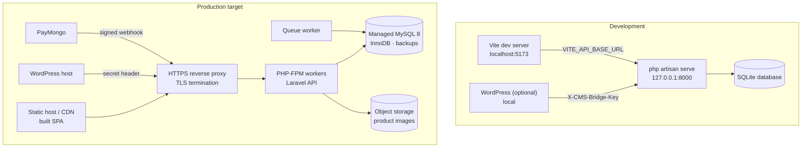

# CraftMarket — System Architecture

**Project Title:** Startup-Oriented Web Application Development with CMS and System Integration (CraftMarket)  
**Courses:** Web Systems and Technologies 2 / System Integration and Architecture 1 (ITE311)  
**Pattern:** Decoupled three-tier architecture (SPA + REST API + relational database) with a headless CMS sidecar

---

## 1. Architectural Overview

CraftMarket separates presentation, business logic, and data so each layer can evolve independently:

- **Presentation tier** — Vue 3 SPA (Vite build, Vue Router, Axios, DOMPurify) served as static assets.
- **Application tier** — Laravel 12 REST API (PHP 8.2+), Sanctum bearer tokens, RBAC middleware, domain services, queued notifications.
- **Data tier** — MySQL 8 / InnoDB in production (SQLite for local development), schema owned by migrations.
- **Content sidecar** — Headless WordPress reads aggregate data through a shared-secret bridge; it never owns transactional data.
- **External services** — PayMongo hosted checkout and signed webhooks.

---

## 2. High-Level Architecture Diagram

---

## 3. Layer Responsibilities

| Layer | Components | Responsibilities | Must not do |
|---|---|---|---|
| **Presentation** | `frontend/src/views`, `components`, `services`, `router`, `composables` | Render UI, route guards, optimistic UI state, call the API through services | Compute authoritative prices, commissions, or permissions |
| **API / application** | `routes/api.php`, controllers, middleware | Validate input, authenticate, authorize, orchestrate transactions, shape JSON responses | Render HTML pages or trust client-calculated totals |
| **Domain** | Controller domain methods, models, services | Commission snapshot, escrow lifecycle, payout balance, verification state, analytics aggregation | Bypass database transactions for money movement |
| **Data** | Migrations, Eloquent models, MySQL | Persist normalized data, enforce FKs/uniques, retain financial snapshots | Store business rules only in application code |
| **Content sidecar** | `cms/craftmarket-sync-plugin` | Editorial content and aggregate reporting | Write transactional tables directly |
| **External** | PayMongo, SMTP | Payment capture, message delivery | Be trusted without signature/credential verification |

---

## 4. Request Lifecycle

### 4.1 Checkout and escrow sequence

---

## 5. Component Diagram

---

## 6. Deployment Architecture

| Concern | Development | Production |
|---|---|---|
| Frontend | `npm run dev` (Vite) | `npm run build` → static CDN |
| API | `php artisan serve` | PHP-FPM behind HTTPS reverse proxy |
| Database | SQLite file | Managed MySQL 8, automated backups |
| Images | `storage/app/public` | Object storage + CDN URLs |
| Queue | `QUEUE_CONNECTION=database` | Dedicated queue worker + supervisor |
| Mail | `MAIL_MAILER=log` or Mailpit | SMTP / transactional email provider |
| Secrets | `.env` (gitignored) | Secret manager / environment variables |
| CORS | localhost allow-list + pattern | Explicit production origins only |
| Tokens | Sanctum, 7-day expiry | Same, with rotation on role change |

---

## 7. Key Architectural Decisions

| Decision | Choice | Rationale | Trade-off |
|---|---|---|---|
| Frontend/backend split | Vue SPA + Laravel REST API | Clear ownership, independently deployable, testable API | More moving parts than a monolith |
| Authentication | Laravel Sanctum bearer tokens | First-party SPA friendly, simple revocation | Requires careful token lifetime handling |
| Authorization | Route middleware + controller guards | Defense in depth for RBAC | Rules duplicated in two places |
| Money storage | `DECIMAL(10,2)` + line-item snapshots | Audit-safe historical totals | Controlled denormalization |
| Escrow | Status on order and line item | Multi-seller orders release independently | More state transitions to test |
| Commission | Snapshot per line item | Plan changes never rewrite past payouts | Must compute at checkout |
| CMS | Headless WordPress sidecar | Marketing autonomy without DB coupling | Extra integration surface |
| CMS security | Shared secret + fail-closed | Prevents PII/report exposure | Manual key rotation |
| Payments | Hosted checkout + signed webhook | No card data touches the app | Dependency on PayMongo |
| Images | UUID filenames + MIME validation | Prevents traversal/collision | Cleanup job needed for orphans |

---

## 8. Non-Functional Architecture Qualities

- **Security:** HTTPS, CORS allow-list, rate limiting, Bcrypt, Sanctum expiry, RBAC, signed webhooks, shared-secret CMS bridge, server-side validation.
- **Integrity:** Transactions around stock, orders, escrow, and payouts; foreign keys; unique constraints; immutable financial snapshots.
- **Performance:** Indexed foreign keys and status columns, paginated catalog, eager loading (`with`) to avoid N+1 queries, aggregated analytics in one request.
- **Scalability:** Stateless API workers behind a load balancer; queue for notifications; object storage for images; read-heavy catalog cacheable at the CDN.
- **Maintainability:** Migrations as schema source of truth, service layer in `frontend/src/services`, consistent JSON envelope, feature tests.
- **Observability:** Structured Laravel logs, webhook audit entries, payout and escrow timestamps, health endpoint at `/up` and `/api`.

---

## 9. Related Documents

- [Use case diagram & specifications](./use-case.md)
- [Context diagram (Level-0 DFD)](./context.md)
- [Entity Relationship Diagram](./erd.md)
- [Database schema](../database/schema.sql)
- [Software Requirements Specification](../SRS/system-requirements.md)
- [Security controls](../security/security-controls.md)
- [Wireframes](./wireframes.md)
