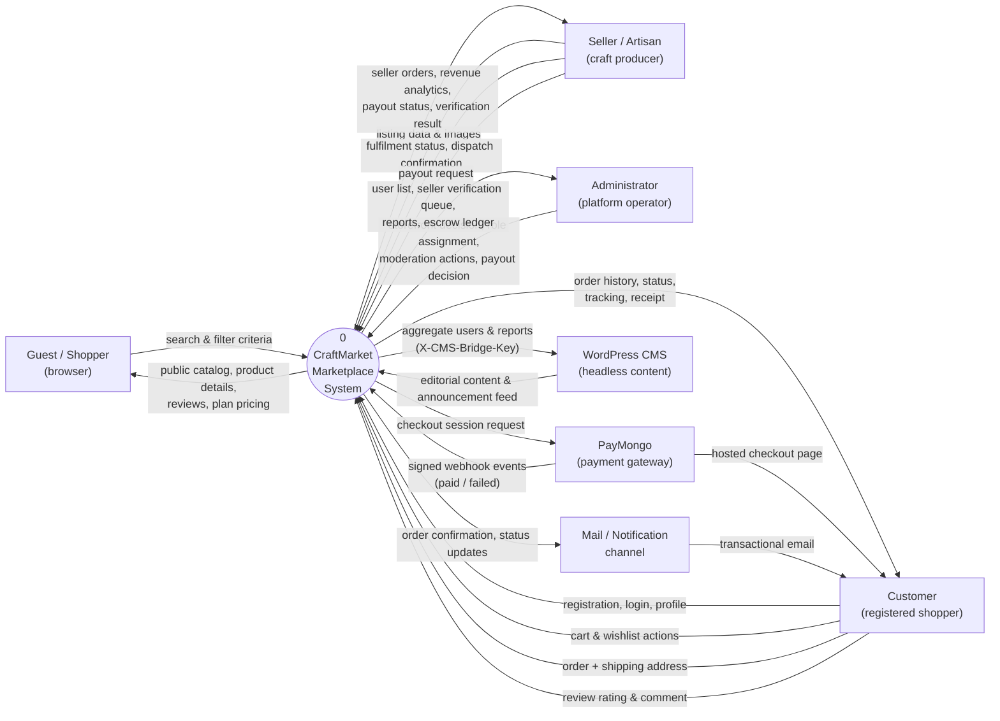
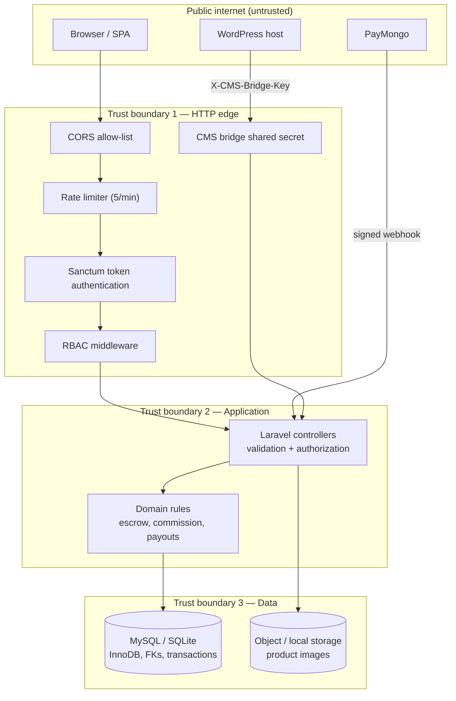

# CraftMarket — Context Diagram (Level-0 Data Flow Diagram)

**Project Title:** Startup-Oriented Web Application Development with CMS and System Integration (CraftMarket)  
**Courses:** Web Systems and Technologies 2 / System Integration and Architecture 1 (ITE311)  
**Notation:** Yourdon/DeMarco Level-0 DFD (single process = the whole system)  
**Companion document:** [`architecture.md`](./architecture.md) for the internal decomposition

---

## 1. Context Diagram

---

## 2. External Entities

| Entity | Inputs to CraftMarket | Outputs from CraftMarket | Interface |
|---|---|---|---|
| **Guest** | Search keywords, filters, product selection | Public catalog, product detail, filter facets, reviews, Artisan Pro plans | Vue SPA → `GET /api/products`, `/api/products/filters`, `/api/products/{id}`, `/api/products/{id}/reviews` |
| **Customer** | Account data, cart/wishlist actions, order and shipping data, review content | Order history, item status, tracking, payment receipt, review eligibility | Sanctum-authenticated SPA → `/api/cart`, `/api/wishlist`, `/api/orders`, `/api/products/{id}/reviews` |
| **Seller** | Storefront profile, listings, images, fulfilment updates, dispatch confirmation, payout request | Seller-scoped orders, revenue analytics, payout status, verification outcome | `/api/seller/*`, `/api/products` (seller role) |
| **Administrator** | Verification decision, moderation actions, role assignment, escrow/payout decisions | Full user list, seller queue, product oversight, combined reports | `/api/admin/*`, `/api/users` (admin role) |
| **PayMongo** | Hosted checkout, signed payment events | Checkout session, line items, success/cancel URLs | `POST /api/payments/checkout-session`, `POST /api/webhooks/paymongo` |
| **WordPress CMS** | Editorial content references, category changes, storefront verification decisions, and CMS-side reporting requests | Aggregate catalog/category/storefront/user/report JSON behind `X-CMS-Bridge-Key` | `/api/cms-bridge/categories`, `/api/cms-bridge/sellers`, `/api/cms-bridge/users`, `/api/cms-bridge/reports` |
| **Mail channel** | Delivery of transactional messages | Order and status notifications | Laravel notification service (SMTP / log driver in development) |

---

## 3. Major Data Flows

| ID | From → To | Data | Notes |
|---|---|---|---|
| DF-01 | Guest → System | Search term, category, seller, price range, availability, sort, page | All query parameters validated; unknown values rejected with `422`. |
| DF-02 | System → Guest | Public catalog page: products, facets, pagination metadata | Only approved storefronts and `active` products. |
| DF-03 | Customer → System | Registration / login credentials | Bcrypt hashing; rate limited to 5 requests/minute/IP. |
| DF-04 | System → Customer | Sanctum bearer token + role profile | Token expires in 7 days by default. |
| DF-05 | Customer → System | Cart and wishlist mutations | Unique per `(user_id, product_id)`. |
| DF-06 | Customer → System | Order request: items, shipping address, contact, payment method | Totals, commission, and shipping are recalculated server-side. |
| DF-07 | System → PayMongo | Checkout session with line items in centavos | Secret key from environment, never exposed to the browser. |
| DF-08 | PayMongo → System | Payment event with HMAC-SHA256 signature | Unsigned or tampered events are rejected. |
| DF-09 | System → Seller | Seller-scoped order items, revenue trend, top crafts, payout balance | Ownership enforced by `seller_id`. |
| DF-10 | Seller → System | Status transition, dispatch code, payout request | State machine + balance rules enforced. |
| DF-11 | System → Administrator | Verification queue, all-product oversight, reports, ledger | Admin-only middleware. |
| DF-12 | Administrator → System | Approve/reject storefront, role change, payout decision | Self-demotion and last-admin guards. |
| DF-13 | System → WordPress | Aggregate catalog, category taxonomy, storefront queue, users, and financial reports | Requires shared secret; fails closed if unset. |
| DF-14 | WordPress → System | Category CRUD and storefront verification decisions | Nonce + `manage_options`; delete guard; seller email notification. |
| DF-15 | System → Mail | Order confirmation, status notifications, storefront verification updates | Queued/logged in development. |

---

## 4. Trust Boundaries

| Boundary | Control |
|---|---|
| Browser → API | CORS origin allow-list, HTTPS in production, bearer tokens, role middleware. |
| PayMongo → API | HMAC-SHA256 signature verification with timestamp; rejects unsigned events. |
| WordPress → API | Shared secret header compared with `hash_equals`; `503` when unconfigured. |
| API → Database | Parameterized Eloquent queries, foreign keys, transactions, server-side totals. |
| API → File storage | MIME/type/size validation, UUID filenames, path traversal protection. |

---

## 5. Scope Notes

**Inside the system**
- Account management and RBAC
- Catalog, categories, search, reviews
- Cart, wishlist, checkout, escrow ledger
- Commission computation and snapshotting
- Seller fulfilment, QR dispatch, analytics, payouts
- Admin verification, moderation, user roles, reports
- CMS bridge and payment webhook handling

**Outside the system**
- PayMongo's own payment processing and card storage
- Courier logistics and last-mile delivery
- WordPress editorial authoring and theme rendering
- Bank/GCash settlement rails used for actual payout disbursement
- Tax computation and statutory remittance
