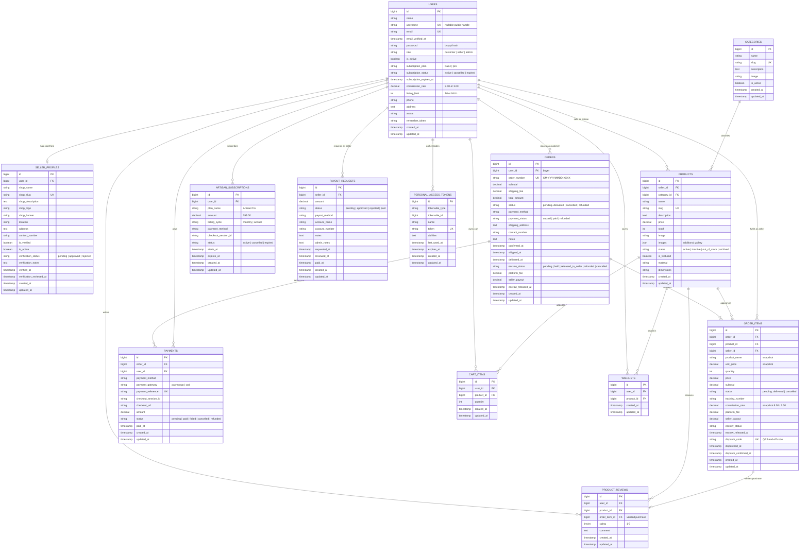

# CraftMarket — Entity Relationship Diagram (ERD)

**Project Title:** Startup-Oriented Web Application Development with CMS and System Integration (CraftMarket)  
**Courses:** Web Systems and Technologies 2 / System Integration and Architecture 1 (ITE311) — BSIT F3  
**Database:** MySQL 8.x / InnoDB, utf8mb4  
**Source of truth:** `backend/database/migrations/` (this document mirrors the executable schema)

---

## 1. Complete ERD

---

## 2. Relationship summary

| Parent | Child | Cardinality | Rule |
|---|---|---|---|
| `users` | `seller_profiles` | 1 : 0..1 | A seller account owns one storefront profile. |
| `users` | `products` | 1 : 0..* | Artisan listings are owned by one seller. |
| `categories` | `products` | 1 : 0..* | Each product belongs to one discipline. |
| `users` | `orders` | 1 : 0..* | A customer places many orders. |
| `orders` | `order_items` | 1 : 1..* | An order always has at least one line item. |
| `products` | `order_items` | 1 : 0..* | A product can be sold in many order items. |
| `users` | `order_items` | 1 : 0..* | Items are fulfilled by their respective artisan. |
| `orders` | `payments` | 1 : 0..* | Payment attempts/records are retained for audit. |
| `users` | `product_reviews` | 1 : 0..* | Customers write reviews. |
| `products` | `product_reviews` | 1 : 0..* | Products receive reviews. |
| `order_items` | `product_reviews` | 1 : 0..1 | A delivered item verifies the purchase. |
| `users` | `cart_items` | 1 : 0..* | Persistent shopping cart per customer. |
| `users` | `wishlists` | 1 : 0..* | Saved products per customer. |
| `users` | `artisan_subscriptions` | 1 : 0..* | Billing history for Artisan Pro. |
| `users` | `payout_requests` | 1 : 0..* | Released escrow cash-out requests. |

---

## 3. Integrity, normalization, and efficiency

### Referential integrity
- Foreign keys use `ON DELETE CASCADE` for dependent rows (profile, cart, wishlist, reviews, subscriptions, payout requests).
- Orders and order items use restrictive deletes so financial history is never lost; deleting an ordered product archives it instead.
- `order_items` stores **snapshots** of `product_name`, `unit_price`, `commission_rate`, `platform_fee`, and `seller_payout`. Historical financial records remain correct even if the product or commission rate later changes.

### Normalization
- The schema is in **Third Normal Form (3NF)**:
  - User identity, storefront details, product data, order headers, and order lines are separated.
  - Commission and payout values are derived once at checkout and stored on the line item (controlled denormalization for financial audit).
  - Cart and wishlist rows are junction tables with unique `(user_id, product_id)` constraints.

### Constraints and indexes
- Unique: `users.email`, `users.username`, `products.slug`, `categories.slug`, `orders.order_number`, `seller_profiles.shop_slug`, `order_items.dispatch_code`, `product_reviews(user_id, product_id)`, `cart_items(user_id, product_id)`, `wishlists(user_id, product_id)`.
- Indexed: payout `(seller_id, status)`, payments `order_id`, `status`, `payment_reference`, reviews `product_id`, `user_id`.
- State transitions are enforced in the controllers (for example delivery releases escrow; only approved payouts can be paid).

### Transactional consistency
- Order placement runs inside a database transaction: stock is validated and decremented, totals are recalculated server-side, and cart rows are cleared atomically.
- Escrow release, refunds, and cancellations update the order header and all line items in one transaction.
- Payout requests are validated against `released_earnings - reserved - paid`, preventing over-withdrawal.

---

## 4. Data dictionary highlights

| Table | Purpose | Key business rule |
|---|---|---|
| `users` | Identity and RBAC | Role is one of `customer`, `seller`, `admin`; inactive accounts cannot log in and tokens are revoked. |
| `seller_profiles` | Artisan storefront | Public listings require `verification_status = approved` and `is_verified = true`. |
| `products` | Craft catalog | Public catalog only shows `status = active` products from approved storefronts. |
| `orders` | Customer order header | Totals are recalculated server-side; escrow status tracks money flow. |
| `order_items` | Multi-seller line items | Each artisan fulfils their own items and receives their own payout snapshot. |
| `payments` | Gateway audit trail | PayMongo references and checkout sessions are retained. |
| `product_reviews` | Verified reviews | Review requires a delivered/completed order item for the same customer and product. |
| `payout_requests` | Seller cash-out | Funded only by released escrow; admin approval then settlement. |
| `artisan_subscriptions` | Pro billing history | ₱299/month recurring subscription records. |
