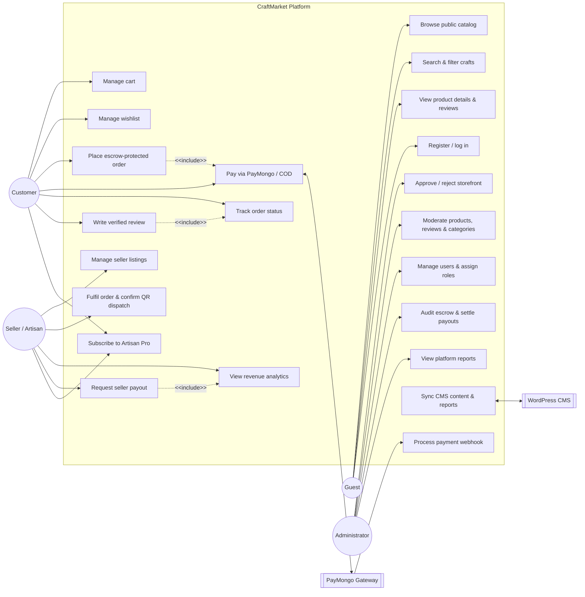

# CraftMarket — Use Case Diagram & Use Case Specifications

**Project:** CraftMarket — Local Handmade Products Marketplace  
**Course:** ITE311 — Web Systems and Technologies 2  
**Student:** Ashley Jay Sarmiento (BSIT F3)

---

## 1. Actors

| Actor | Type | Description |
|---|---|---|
| **Guest** | Primary | Unauthenticated visitor who can browse the public catalog, search and filter crafts, open product details, read reviews, and view the Artisan Pro plans. |
| **Customer** | Primary | Registered shopper who manages a cart and wishlist, checks out through escrow, tracks orders, and writes verified reviews. |
| **Seller (Artisan)** | Primary | Verified craft producer who manages listings, fulfils orders, confirms QR dispatch, monitors revenue analytics, and requests payouts. |
| **Administrator** | Primary | Platform operator who approves storefronts, moderates catalog and reviews, manages users and roles, audits escrow, and settles payouts. |
| **PayMongo** | Secondary / System | External payment gateway that hosts checkout and sends signed webhook events back to the API. |
| **WordPress CMS** | Secondary / System | Headless content system that reads aggregate bridge data (with a shared secret) for editorial and reporting dashboards. |

---

## 2. Use Case Diagram

### 2.1 Use case relationships

| Relationship | From | To | Rationale |
|---|---|---|---|
| `«include»` | Place order (UC07) | Pay via PayMongo / COD (UC08) | Every order must be settled or explicitly marked COD. |
| `«include»` | Write review (UC10) | Track order status (UC09) | A review is only allowed when an order item is delivered. |
| `«include»` | Request payout (UC14) | View revenue analytics (UC13) | Payout amount is bounded by released escrow shown in analytics. |
| `«extend»` | Subscribe to Artisan Pro (UC20) | Pay via PayMongo (UC08) | Pro billing reuses the hosted checkout session flow. |
| `«extend»` | Place order (UC07) | Manage cart (UC05) | Checkout normally consumes cart items, but the API also accepts a direct item list. |

---

## 3. Use Case Specifications

### UC-01 Browse Public Catalog

| Field | Detail |
|---|---|
| **Actor** | Guest, Customer |
| **Precondition** | None. |
| **Trigger** | Visitor opens the home page or Shop page. |
| **Main flow** | 1. SPA calls `GET /api/products`. 2. API returns only `active` products whose seller storefront is `approved` and `is_verified = true`. 3. SPA renders craft cards with price, stock badge, rating, and seller shop name. 4. Visitor may open a product detail page. |
| **Alternate flow** | A1. API offline → SPA falls back to bundled sample data so the UI remains demonstrable. A2. No products match → empty-state message is shown. |
| **Postcondition** | Catalog is displayed; unverified storefronts are never exposed. |
| **Traceability** | FR-CAT-01, FR-CAT-02, FR-SEC-04 |

### UC-02 Search & Filter Crafts

| Field | Detail |
|---|---|
| **Actor** | Guest, Customer |
| **Main flow** | 1. Visitor applies keyword, category, seller, price range, availability, or sort option. 2. SPA calls `GET /api/products` with query parameters. 3. API validates each parameter, filters the approved-storefront query, and paginates results. 4. Filter facets come from `GET /api/products/filters`, which counts only publicly visible crafts. |
| **Postcondition** | Result set and facet counts are consistent with the public catalog. |
| **Traceability** | FR-CAT-03, FR-CAT-04 |

### UC-03 View Product Details & Reviews

| Field | Detail |
|---|---|
| **Actor** | Guest, Customer |
| **Main flow** | 1. Visitor opens `/products/:id`. 2. API loads product, category, seller, and seller storefront. 3. If the storefront is not approved, the API returns `404` (no information leakage). 4. SPA renders gallery, price, stock, material, dimensions, and reviews from `GET /api/products/{id}/reviews`. |
| **Postcondition** | Only publicly visible products are reachable by direct link. |
| **Traceability** | FR-CAT-05, FR-SEC-04 |

### UC-04 Register / Log In

| Field | Detail |
|---|---|
| **Actor** | Guest |
| **Main flow** | 1. Visitor submits name, email, password (and optional phone/address). 2. API validates input, hashes the password with Bcrypt, creates a `customer` by default, and issues a Sanctum bearer token. 3. On login, credentials are verified and an active account receives a token. 4. SPA stores the token and redirects by role. |
| **Alternate flow** | A1. More than 5 attempts per minute from one IP → `429 Too Many Requests`. A2. Deactivated account → `403` with a clear message. A3. Duplicate email → `422` validation error. |
| **Postcondition** | Authenticated session with role-scoped access. |
| **Traceability** | FR-AUTH-01…FR-AUTH-05, NFR-SEC-01, NFR-SEC-02 |

### UC-05 Manage Cart

| Field | Detail |
|---|---|
| **Actor** | Customer |
| **Main flow** | 1. Customer adds a craft from the product page. 2. `POST /api/cart` upserts a row keyed by `(user_id, product_id)` and validates available stock. 3. Customer updates quantity (`PUT /api/cart/{id}`) or removes an item (`DELETE /api/cart/{id}`). 4. Cart totals are recomputed by the SPA, but the server always recalculates authoritative totals at checkout. |
| **Postcondition** | Persistent cart stored in MySQL, not only in browser state. |
| **Traceability** | FR-ORD-01, FR-ORD-02 |

### UC-06 Manage Wishlist

| Field | Detail |
|---|---|
| **Actor** | Customer |
| **Main flow** | 1. Customer taps the heart icon on any craft card or detail page. 2. `POST /api/wishlist` stores a unique `(user_id, product_id)` row. 3. The Wishlist tab lists saved crafts and supports removal (`DELETE /api/wishlist/{productId}`). |
| **Postcondition** | Saved crafts persist across devices and sessions. |
| **Traceability** | FR-ORD-03 |

### UC-07 Place Escrow-Protected Order

| Field | Detail |
|---|---|
| **Actor** | Customer |
| **Precondition** | Authenticated; cart has at least one in-stock craft. |
| **Main flow** | 1. Customer enters shipping address and contact number. 2. SPA calls `POST /api/orders`. 3. API validates items, locks products, verifies stock, and snapshots `product_name` and `unit_price`. 4. API snapshots each seller's commission (`8%` Basic or `3%` Pro) and computes `platform_fee` and `seller_payout` per line item. 5. Shipping is free at ₱1,500+; otherwise ₱150. 6. Order is created with a unique `CM-YYYYMMDD-XXXX` number, stock is decremented, cart rows are cleared, and the whole operation runs in one transaction. 7. Escrow starts as `pending` and becomes `held` once payment is confirmed. |
| **Alternate flow** | A1. Insufficient stock → `422` with the affected craft. A2. Unverified seller product → rejected by the public catalog rule. A3. Zero/negative quantity → validation error. |
| **Postcondition** | Order header + line items exist with immutable financial snapshots. |
| **Traceability** | FR-ORD-04…FR-ORD-09, FR-PAY-01, FR-PAY-02 |

### UC-08 Pay via PayMongo / COD

| Field | Detail |
|---|---|
| **Actor** | Customer, PayMongo |
| **Main flow** | 1. For online payment, SPA calls `POST /api/payments/checkout-session`. 2. API creates a PayMongo checkout session with line items (including shipping) and returns `checkout_url`. 3. Customer pays on PayMongo. 4. PayMongo sends a signed webhook to `POST /api/webhooks/paymongo`. 5. API verifies the HMAC-SHA256 signature, marks the payment `paid`, sets the order to `confirmed`, and moves escrow to `held`. 6. COD orders are recorded with `payment_gateway = cod` and settled on delivery. |
| **Alternate flow** | A1. Invalid signature → `401`, event logged and ignored. A2. Duplicate event → idempotent handling; no double payment row. A3. Failed payment → payment `failed`, escrow unchanged. |
| **Postcondition** | Payment audit trail is complete and escrow reflects collected funds. |
| **Traceability** | FR-PAY-03…FR-PAY-07, NFR-SEC-05 |

### UC-09 Track Order Status

| Field | Detail |
|---|---|
| **Actor** | Customer, Seller, Admin |
| **Main flow** | 1. Customer opens My Orders and sees status badges per item. 2. Seller updates fulfilment status (`pending → confirmed → processing → shipped → delivered`). 3. When an item is marked `delivered`, the API releases that line item's escrow to the seller and records `escrow_released_at`. 4. Customer sees tracking number and dispatch confirmation. |
| **Postcondition** | Status history is visible and escrow release is tied to delivery. |
| **Traceability** | FR-ORD-10, FR-ORD-11 |

### UC-10 Write Verified Review

| Field | Detail |
|---|---|
| **Actor** | Customer |
| **Precondition** | The customer has a delivered/completed order item for that product. |
| **Main flow** | 1. SPA calls `GET /api/products/{id}/reviews/eligibility`. 2. If eligible, the customer submits a 1–5 rating and comment. 3. API validates the rating range, sanitizes text, enforces one review per `(user_id, product_id)`, and stores `order_item_id` as proof of purchase. 4. Product average rating and review count update automatically. |
| **Alternate flow** | A1. No delivered purchase → `403`. A2. Duplicate review → `422` (edit existing review instead). |
| **Postcondition** | Only verified buyers can publish reviews. |
| **Traceability** | FR-REV-01…FR-REV-04 |

### UC-11 Manage Seller Listings

| Field | Detail |
|---|---|
| **Actor** | Seller |
| **Precondition** | Authenticated seller; storefront may be pending approval. |
| **Main flow** | 1. Seller opens the Products tab. 2. Creating a craft requires name, category, price, stock, description, and image. 3. API validates fields, generates a unique slug, enforces the plan listing limit (10 for Basic, unlimited for Pro), and stores the image with a UUID filename. 4. Seller may edit, archive, or delete a listing. 5. New crafts from a pending storefront stay hidden from the public catalog until approval. |
| **Alternate flow** | A1. Basic plan limit reached → `422` asking the seller to upgrade. A2. Invalid image type or size → `422`. |
| **Postcondition** | Listing is stored and ownership is enforced (`seller_id`). |
| **Traceability** | FR-SEL-01…FR-SEL-05 |

### UC-12 Fulfil Order & Confirm QR Dispatch

| Field | Detail |
|---|---|
| **Actor** | Seller |
| **Main flow** | 1. Seller views only their own order items. 2. Seller moves an item through fulfilment states. 3. Seller generates a dispatch code (`POST /seller/order-items/{id}/dispatch-code`) shown as a QR code. 4. Courier scans/enters the code; seller confirms hand-off (`POST /seller/order-items/{id}/dispatch-confirm`). 5. On delivery, escrow is released for that item. |
| **Postcondition** | Chain of custody is recorded with timestamps. |
| **Traceability** | FR-SEL-06, FR-ORD-11 |

### UC-13 View Revenue Analytics

| Field | Detail |
|---|---|
| **Actor** | Seller |
| **Main flow** | 1. Seller opens the Overview tab. 2. `GET /api/seller/stats` returns total sales, order counts, average order value, this-month and last-month revenue, growth percentage, a six-month sales trend, and the top five crafts by revenue. 3. SPA renders summary tiles, a responsive bar chart, and a top-selling list. |
| **Postcondition** | Seller sees only their own sales data. |
| **Traceability** | FR-SEL-07, FR-SEL-08 |

### UC-14 Request Seller Payout

| Field | Detail |
|---|---|
| **Actor** | Seller |
| **Precondition** | Seller has released escrow earnings not already reserved or paid. |
| **Main flow** | 1. Seller opens the Payouts tab and sees available balance. 2. Seller submits amount, method (GCash/bank), account name, and account number. 3. API validates that `amount > 0` and `amount ≤ released − reserved − paid`. 4. Request is stored as `pending`; the amount is reserved. 5. Seller may cancel a pending request, which releases the reservation. |
| **Alternate flow** | A1. Amount exceeds available balance → `422`. A2. Admin rejects → reserved amount becomes available again. |
| **Postcondition** | Payout request is queued for admin settlement. |
| **Traceability** | FR-PAY-08…FR-PAY-11 |

### UC-15 Approve / Reject Storefront

| Field | Detail |
|---|---|
| **Actor** | Administrator |
| **Main flow** | 1. Admin opens the Sellers tab and filters by verification status. 2. Admin reviews shop name, bio, location, and contact details. 3. `PATCH /api/admin/sellers/{id}/verification` sets `approved` or `rejected`, writes notes, and stamps `verified_at` / `verification_reviewed_at`. 4. Approval flips `is_verified = true`; the seller's crafts become publicly visible. 5. Rejection hides the storefront and returns a reason to the seller. |
| **Postcondition** | Public visibility is directly controlled by admin approval. |
| **Traceability** | FR-ADM-01…FR-ADM-03 |

### UC-16 Moderate Products, Reviews & Categories

| Field | Detail |
|---|---|
| **Actor** | Administrator |
| **Main flow** | 1. Admin uses `GET /api/admin/products` to see **all** products, including pending/rejected storefronts. 2. Admin edits or archives inappropriate listings. 3. Admin reviews flagged reviews and deletes policy violations. 4. Admin creates, renames, or deactivates categories. |
| **Postcondition** | Admin oversight is broader than the public catalog, without weakening public filtering. |
| **Traceability** | FR-ADM-04…FR-ADM-06 |

### UC-17 Manage Users & Assign Roles

| Field | Detail |
|---|---|
| **Actor** | Administrator |
| **Main flow** | 1. Admin searches and filters users by role and active status. 2. Admin opens the audit modal and changes the role (`customer`, `seller`, `admin`). 3. API blocks self-demotion, self-deactivation, and demotion of the last administrator. 4. Promoting to seller provisions a `pending` storefront automatically. 5. Role change or deactivation revokes all existing Sanctum tokens, forcing a fresh login with the new RBAC scope. |
| **Alternate flow** | A1. Self-demotion → `422`. A2. Last admin demotion → `422`. A3. Deactivation → tokens revoked immediately. |
| **Postcondition** | Role changes are safe, auditable, and immediately effective. |
| **Traceability** | FR-ADM-07…FR-ADM-10, NFR-SEC-03 |

### UC-18 Audit Escrow & Settle Payouts

| Field | Detail |
|---|---|
| **Actor** | Administrator |
| **Main flow** | 1. Admin opens the Payouts tab. 2. Admin sees pending, approved, paid, and rejected totals. 3. `PATCH /api/admin/payouts/{id}` moves a request to `approved`, `rejected`, or `paid` and records `reviewed_at` / `paid_at`. 4. Admin can also release escrow manually via `PATCH /api/admin/orders/{id}/escrow` when an exception requires it. |
| **Postcondition** | Money movement is traceable and status transitions are one-way. |
| **Traceability** | FR-PAY-12…FR-PAY-14 |

### UC-19 View Platform Reports

| Field | Detail |
| --- | --- |
| **Actor** | Administrator |
| **Main flow** | 1. Admin opens the Reports tab. 2. `GET /api/admin/reports` returns realized sales, order counts, average order value, status summaries, best sellers, most active sellers, commission ledger, payout summary, and subscription revenue (Pro MRR and all-time). 3. SPA renders KPI cards, ledger table, and settlement cards. |
| **Postcondition** | Admin sees a complete financial picture of the platform. |
| **Traceability** | FR-ADM-11, FR-ADM-12 |

### UC-20 Subscribe to Artisan Pro

| Field | Detail |
|---|---|
| **Actor** | Seller |
| **Main flow** | 1. Seller compares Basic and Pro plans (`GET /api/subscriptions/plans`). 2. Seller starts checkout (`POST /api/seller/subscription/upgrade`). 3. PayMongo checkout completes; the API verifies the session and activates Pro. 4. Account switches to `commission_rate = 3.00`, `listing_limit = NULL`, and Pro badge. 5. Billing history is stored in `artisan_subscriptions`. |
| **Alternate flow** | A1. Seller cancels → returns to Basic 8% at period end. A2. Payment verification fails → plan unchanged. |
| **Postcondition** | Commission and listing limits reflect the active plan. |
| **Traceability** | FR-SUB-01…FR-SUB-04 |

### UC-21 Sync CMS Content & Reports

| Field | Detail |
|---|---|
| **Actor** | WordPress CMS |
| **Main flow** | 1. The plugin calls `/api/cms-bridge/users` or `/api/cms-bridge/reports` with the `X-CMS-Bridge-Key` header. 2. API compares the header to `CMS_BRIDGE_KEY` using a constant-time comparison. 3. Matching requests receive JSON data; missing or incorrect keys receive `401`. |
| **Alternate flow** | A1. Key not configured on the server → `503` (fail closed). |
| **Postcondition** | Aggregate CMS data is shared securely, while transactional data stays read-only in Laravel. |
| **Traceability** | FR-CMS-01, FR-CMS-02, NFR-SEC-06 |

### UC-22 Process Payment Webhook

| Field | Detail |
|---|---|
| **Actor** | PayMongo |
| **Main flow** | 1. PayMongo posts an event with a `paymongo-signature` header. 2. API verifies the HMAC-SHA256 signature and timestamp. 3. API updates payment and order state inside a transaction. 4. Escrow moves to `held` for successful payments. |
| **Postcondition** | Payment state is consistent with the gateway, without trusting unsigned callbacks. |
| **Traceability** | FR-PAY-05, NFR-SEC-05 |

---

## 4. Role–Use Case Matrix

| Use case | Guest | Customer | Seller | Admin |
|---|:---:|:---:|:---:|:---:|
| UC-01 Browse catalog | ✅ | ✅ | ✅ | ✅ |
| UC-02 Search & filter | ✅ | ✅ | ✅ | ✅ |
| UC-03 View product & reviews | ✅ | ✅ | ✅ | ✅ |
| UC-04 Register / log in | ✅ | — | — | — |
| UC-05 Manage cart | — | ✅ | — | — |
| UC-06 Manage wishlist | — | ✅ | — | — |
| UC-07 Place order | — | ✅ | — | — |
| UC-08 Pay online / COD | — | ✅ | — | — |
| UC-09 Track order | — | ✅ | ✅ | ✅ |
| UC-10 Write review | — | ✅ | — | — |
| UC-11 Manage listings | — | — | ✅ | ✅ |
| UC-12 Fulfil & dispatch | — | — | ✅ | — |
| UC-13 Revenue analytics | — | — | ✅ | — |
| UC-14 Request payout | — | — | ✅ | — |
| UC-15 Approve storefront | — | — | — | ✅ |
| UC-16 Moderate content | — | — | — | ✅ |
| UC-17 Manage users/roles | — | — | — | ✅ |
| UC-18 Audit escrow / payouts | — | — | — | ✅ |
| UC-19 Platform reports | — | — | — | ✅ |
| UC-20 Artisan Pro | — | — | ✅ | — |
| UC-21 CMS bridge sync | — | — | — | system |
| UC-22 Payment webhook | — | — | — | system |
