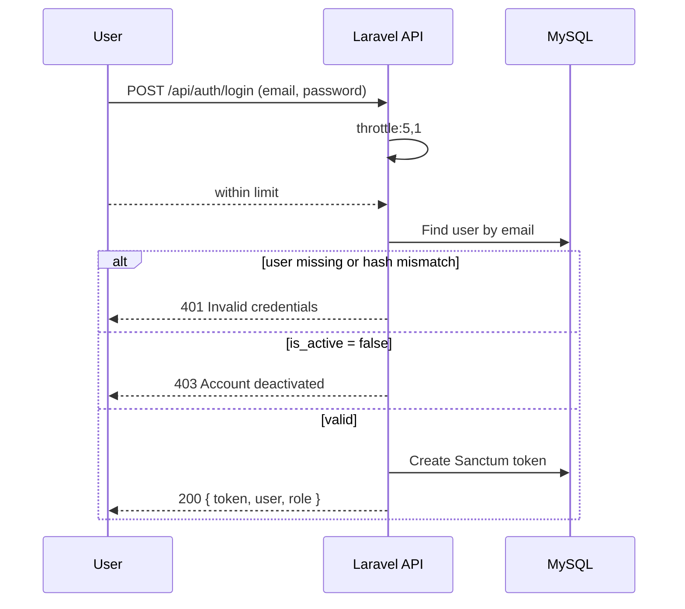

# CraftMarket — Security & Validation Controls

**Project:** CraftMarket — Local Handmade Products Marketplace  
**Course:** ITE311 — Web Systems and Technologies 2  
**Scope:** Authentication, authorization, input validation, data protection, payment integrity, and OWASP Top 10 (2021) mapping

---

## 1. Security Architecture Summary

CraftMarket uses **defense in depth**:

1. **Transport** — HTTPS/TLS at the reverse proxy in production.
2. **Edge** — restrictive CORS allow-list and per-IP rate limiting on credential endpoints.
3. **Identity** — Laravel Sanctum bearer tokens with a 7-day expiry and server-side revocation.
4. **Authorization** — `role:*` middleware at the route level plus ownership checks inside controllers.
5. **Input** — Laravel validation on every mutating endpoint, parameterized Eloquent queries, MIME/size checks on uploads.
6. **Output** — JSON-only API, Vue template escaping, DOMPurify on CMS-rendered HTML.
7. **Integrity** — database transactions, foreign keys, unique constraints, immutable commission snapshots, escrow state machine.
8. **Third parties** — HMAC-SHA256 webhook verification and a shared-secret CMS bridge that fails closed.

---

## 2. Authentication Controls

| Control | Implementation | Evidence |
|---|---|---|
| Password hashing | Bcrypt via Laravel `hashed` cast and `Hash::make`; never stored or returned in plaintext | `User::$casts`, `AuthController` |
| Password concealment | `password` and `remember_token` in `$hidden` | `App\Models\User` |
| Token authentication | Laravel Sanctum personal access tokens (`Authorization: Bearer …`) | `routes/api.php` → `auth:sanctum` |
| Token expiry | 7 days by default (`SANCTUM_EXPIRATION=10080`) | `config/sanctum.php` |
| Token revocation | All tokens deleted on role change and on account deactivation | `UserController::update` |
| Inactive account block | Login rejects `is_active = false` | `AuthController::login` |
| Brute-force protection | `throttle:5,1` on `/api/auth/register` and `/api/auth/login` | `routes/api.php` |
| Password change | Requires current password confirmation | `AuthController::changePassword` |
| Session isolation | Role and user ID are read from the token's user, never trusted from the request body | Controllers |

**Login flow**



---

## 3. Authorization (RBAC)

### 3.1 Route-level roles

| Route group | Middleware | Allowed roles |
|---|---|---|
| Public catalog, reviews read, plan pricing | none | Guest, any |
| Auth, cart, wishlist, orders, payments, reviews write | `auth:sanctum` | Any authenticated |
| Product create/update/delete, image upload | `auth:sanctum` + `role:seller,admin` | Seller, Admin |
| `/api/seller/*` dashboard, fulfilment, payouts | `auth:sanctum` + `role:seller,admin` | Seller, Admin |
| `/api/admin/*`, category CRUD, user management | `auth:sanctum` + `role:admin` | Admin only |
| `/api/cms-bridge/*` | `cms.bridge` (shared secret) | WordPress bridge |

### 3.2 Ownership and object-level checks

| Resource | Check | File |
|---|---|---|
| Orders | Customer sees only own orders; seller sees orders containing own items; admin sees all | `OrderController::index`, `show` |
| Order status updates | Buyer may cancel own order; seller may update own items; admin may update any | `OrderController::updateStatus` |
| Seller products | Seller is locked to own `seller_id`; admin may query any seller | `SellerController::products` |
| Seller order items | Updates constrained to `seller_id = auth id` | `SellerController::updateItemStatus` |
| Payouts | Seller sees and cancels only own requests | `SellerController::payouts`, `cancelPayout` |
| Reviews | Edit/delete only by author (or admin for moderation) | `ProductReviewController` |
| Products in catalog | Public visibility requires approved storefront | `ProductController::index`, `filters`, `show` |
| CMS bridge | Constant-time shared-secret comparison | `VerifyCmsBridgeKey` |

### 3.3 Administrative safety rails

| Guard | Behaviour | Test |
|---|---|---|
| Self-demotion | Admin cannot change own role → `422` | `test_admin_cannot_demote_their_own_account` |
| Self-deactivation | Admin cannot deactivate own account → `422` | Controller guard |
| Last-admin protection | The final admin cannot be demoted → `422` | Controller guard |
| Seller provisioning | Promotion to seller creates a `pending` storefront automatically | `test_admin_can_assign_a_role_and_provisions_a_pending_storefront` |
| Token invalidation | Role change or deactivation revokes all tokens | `UserController::update` |
| Admin product oversight | `/api/admin/products` can include unverified shops, public catalog cannot | `test_admin_product_oversight_includes_pending_storefronts` |

---

## 4. Input Validation

| Domain | Rules | Why |
|---|---|---|
| Registration | `name` required, valid unique `email`, `password` minimum length + confirmation, optional phone/address limits | Prevents malformed and duplicate accounts |
| Login | Valid email format, required password | Normalizes credentials |
| Products | Required name/category/price/stock, numeric non-negative price, integer stock, slug uniqueness, status enum | Stops negative prices and invalid states |
| Search/filter | `search ≤ 100`, numeric price bounds, enum `availability`, `status`, boolean `featured`, bounded `per_page` (1–100), `page ≥ 1` | Prevents expensive or invalid queries |
| Cart | `product_id` exists, quantity ≥ 1, stock check | Prevents overselling |
| Orders | Items array min 1, each `product_id` exists, quantity ≥ 1, required shipping address/contact, optional payment method | Stops empty or malformed orders |
| Reviews | Rating integer 1–5, comment length-bounded, eligibility and duplicate checks | Prevents fake or malformed reviews |
| Payouts | Positive amount, method/account required, amount ≤ available balance | Prevents over-withdrawal |
| Uploads | File required, `image`, MIME `jpeg/jpg/png/webp`, max size, UUID filename | Prevents executable uploads and traversal |
| Admin updates | Role enum, boolean `is_active`, optional password hashed | Stops arbitrary privilege strings |

**Server-side authority:** the API **never trusts** client-supplied prices, subtotals, commission, shipping, or totals. It reloads products, locks rows, recalculates every amount, and snapshots the result.

---

## 5. Data Protection

| Data | At rest | In transit | Access |
|---|---|---|---|
| Passwords | Bcrypt hash | TLS | Never serialized (`$hidden`) |
| Sanctum tokens | Hashed token lookup in `personal_access_tokens` | Bearer header over TLS | Revocable per user |
| Personal info (email, phone, address) | MySQL, least-privilege DB user | TLS | Own profile; admin user management only |
| Order/financial data | MySQL with FK + transaction | TLS | Buyer, fulfilling seller, admin |
| Product images | Storage with UUID names | TLS / CDN | Public read, seller write |
| Payment data | **No card data stored** — PayMongo hosts checkout | TLS | Gateway only |
| Secrets | `.env` / environment (gitignored) | — | Deployment environment only |
| CMS bridge key | Environment variable | Custom header over TLS | WordPress plugin only |

**PII exposure fix:** the CMS bridge was previously mounted as public GET routes. It is now protected by `VerifyCmsBridgeKey`, returns `401` for missing/incorrect keys, and `503` when no key is configured, so it **fails closed** instead of leaking user and revenue data.

---

## 6. Payment and Financial Integrity

| Control | Implementation |
|---|---|
| Webhook authenticity | HMAC-SHA256 signature verification with timestamp; unsigned/invalid events rejected |
| Idempotency | Payment records are matched by reference; repeated events do not double-credit |
| Escrow lifecycle | `pending → held → released_to_seller`; `pending/held → refunded / cancelled` |
| Delivery-gated release | Escrow releases per line item only when that item is `delivered` |
| Commission snapshot | `commission_rate`, `platform_fee`, `seller_payout` frozen at checkout |
| Shipping policy | Server computes ₱150 or free at ₱1,500+ |
| Payout ceiling | `amount ≤ released earnings − reserved − paid` |
| Payout state machine | `pending → approved → paid`, or `pending → rejected`; rejected funds become available |
| Transaction safety | Order placement, escrow release, refunds, and payouts run in DB transactions |
| Race-condition control | `lockForUpdate()` on product rows during checkout |
| Audit timestamps | `confirmed_at`, `shipped_at`, `delivered_at`, `escrow_released_at`, `reviewed_at`, `paid_at` |
| Local sandbox simulation | Developer-only fallback: requires `APP_ENV=local/testing` **and** `PAYMONGO_ALLOW_SIMULATION=true`; owner-only, pending-session only; records are tagged `payment_gateway=paymongo_sandbox` and `payment_reference=SIMULATED-…`; unreachable in production |

---

## 7. Web Security Controls

| Threat | Control |
|---|---|
| SQL injection | Eloquent/query-builder parameter binding; no raw user input in SQL |
| XSS (API) | JSON-only responses; Vue escapes interpolation by default |
| XSS (CMS content) | DOMPurify sanitizes any HTML rendered from WordPress |
| CSRF | Bearer-token API (no cookie session for API auth), so cross-site form posts cannot act as the user |
| CORS abuse | Explicit origin allow-list plus localhost-only pattern for development |
| Clickjacking | App served standalone; production should add `X-Frame-Options: DENY` / `frame-ancestors` |
| MIME sniffing | Production should add `X-Content-Type-Options: nosniff` |
| Brute force | `throttle:5,1` on auth endpoints |
| Enumeration | Generic `401` for invalid credentials; unverified products return `404` |
| Path traversal | UUID filenames, `storeAs` on a fixed disk, MIME validation |
| Mass assignment | Explicit `$fillable` on every model; only validated keys reach `update()` |
| IDOR | Ownership checks on every user-scoped resource |
| Secret leakage | `.env` gitignored; `.env.example` contains placeholders only |
| Error leakage | API returns structured `{ success, message, data }`; `APP_DEBUG=false` in production |
| Dependency risk | Lockfiles committed; `npm audit` / `composer audit` in CI |

---

## 8. OWASP Top 10 (2021) Mapping

| OWASP category | CraftMarket control | Status |
|---|---|---|
| **A01 Broken Access Control** | Sanctum auth, `role:*` middleware, ownership checks, self-demotion/last-admin guards, admin-only oversight endpoint | ✅ Implemented |
| **A02 Cryptographic Failures** | Bcrypt passwords, TLS, hashed tokens, secrets in env, no card data stored | ✅ Implemented |
| **A03 Injection** | Eloquent parameter binding, strict validation, JSON-only output, DOMPurify | ✅ Implemented |
| **A04 Insecure Design** | Escrow state machine, payout ceiling, server-side totals, verified-storefront gating | ✅ Implemented |
| **A05 Security Misconfiguration** | CORS allow-list, debug off in production, `.env.example` placeholders, security headers recommended | ⚠️ Headers pending at proxy |
| **A06 Vulnerable Components** | Lockfiles, Laravel/Vue maintained versions, audit commands in CI | ✅ Process in place |
| **A07 Identification/Auth Failures** | Rate limiting, token expiry, revocation on role change, inactive-account block | ✅ Implemented |
| **A08 Software/Data Integrity** | Signed webhooks, immutable financial snapshots, transactional writes | ✅ Implemented |
| **A09 Logging/Monitoring Failures** | Laravel logs, webhook warnings, audit timestamps; centralized monitoring is future work | ⚠️ Partial |
| **A10 SSRF** | No user-supplied URLs are fetched server-side; CMS endpoint is fixed/trusted | ✅ Implemented |

---

## 9. Validation Test Evidence

`backend/tests/Feature/SecurityAndAuthorizationTest.php` — **9 tests, 43 assertions**

| Test | What it proves |
|---|---|
| `test_guests_cannot_access_protected_admin_endpoints` | Guest requests to admin/seller endpoints return `401` |
| `test_customers_and_sellers_cannot_access_admin_endpoints` | RBAC returns `403` for wrong roles |
| `test_admin_can_assign_a_role_and_provisions_a_pending_storefront` | Role assignment works and provisions a pending shop |
| `test_admin_cannot_demote_their_own_account` | Self-demotion is blocked with `422` |
| `test_public_catalog_only_lists_products_from_approved_storefronts` | Unverified shops are hidden from list and detail |
| `test_admin_product_oversight_includes_pending_storefronts` | Admin can still see everything for moderation |
| `test_seller_analytics_returns_six_month_trend_and_top_products` | Analytics are seller-scoped and structurally correct |
| `test_cms_bridge_requires_a_shared_secret` | Missing/wrong key → `401`; correct key → `200` |
| `test_admin_reports_include_payout_and_subscription_summary` | Financial summaries are admin-only and correct |

Additional coverage: `OrderEscrowTest` (5 tests) verifies commission split, Pro payout, escrow on payment, release on delivery, and refund on cancellation. `SellerPayoutAndVerificationTest` (8 tests) verifies storefront approval and payout balance rules.

```powershell
cd backend
php artisan test
```

---

## 10. Known Limitations & Hardening Roadmap

| Gap | Risk | Recommended next step |
|---|---|---|
| No multi-factor authentication | Account takeover via stolen password | Add TOTP for sellers/admins |
| No centralized audit log table | Limited forensic reconstruction | Add `audit_logs` with actor, action, entity, IP |
| No security headers at app layer | Clickjacking/MIME sniffing | Set `X-Frame-Options`, `nosniff`, `Referrer-Policy`, CSP at proxy |
| Email verification optional | Fake accounts | Enforce verification before first listing |
| No automated dependency scanning in CI | Supply-chain risk | Add `composer audit` + `npm audit` to CI |
| Rate limiting is per-IP only | Distributed attacks | Add per-account throttling and CAPTCHA after repeated failures |
| No field-level encryption | DB compromise exposes PII | Encrypt phone/address at rest or tokenize |
| Secrets in `.env` | Rotation discipline required | Move to a secret manager |
| No 2-person approval for large payouts | Insider risk | Dual-control for payouts above a threshold |
| No WAF | Volumetric/bot traffic | Add CDN/WAF rules |
